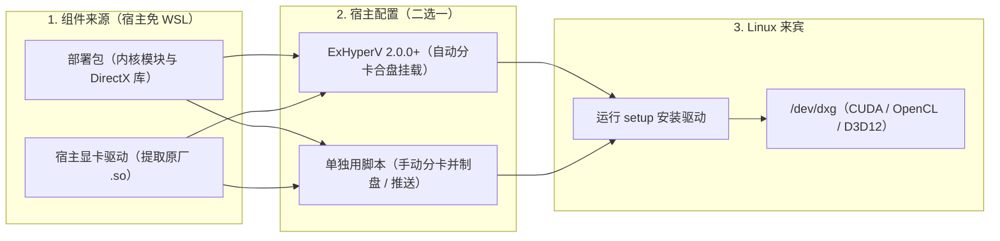

<p align="center">
  
</p>

<h1 align="center">hyperv-linux-gpupv</h1>

<p align="center">
  <strong>还在费劲给 Linux 虚拟机装显卡驱动呢？我们早都研究完了。</strong>
</p>

在 Windows Hyper-V（x64 与 ARM64）的 Linux 虚拟机中使用宿主物理显卡（GPU-PV），**宿主机无需安装 WSL**。支持单卡或多卡同时接入，目前优先用于 **GPU 计算**（`/dev/dxg`、CUDA、`nvidia-smi`、OpenCL、D3D12 Compute）。

按宿主架构前往 [Releases](https://github.com/Justsenger/hyperv-linux-gpupv/releases) 下载对应部署包，并用同批 `SHA256SUMS` 校验：

- `linuxpv-bundle-x86_64-<version>.zip`（Windows x64 宿主与 `x86_64` Linux 虚拟机）
- `linuxpv-bundle-aarch64-<version>.zip`（Windows ARM64 宿主与 `aarch64` Linux 虚拟机）

## 整体流程



## 适用范围

| 项目 | 说明 |
| --- | --- |
| 架构 | Windows x64 + Linux `x86_64`，以及 Windows ARM64 + Linux `aarch64` |
| 来宾系统 | 标准可写根的 `glibc` 发行版。主流发行版内核直接安装预编译模块，其余内核自动回落源码编译 |
| 宿主显卡 | 不限显卡厂商、支持多卡混插，要求宿主当前 Windows 驱动包含 WSL / GPU-PV 运行库 |
| Secure Boot | 支持开启与关闭两种模式（开启时需来宾安装 `shim`、`mokutil`、`openssl` 并在首次安装时录入 MOK） |
| 暂不支持 | `musl` 系统（如 Alpine）、只读/不可变系统（如 NixOS、Fedora Silverblue）、缺少页固定接口或未导出所需 Hyper-V 符号的内核（如未升级 HWE 的 Ubuntu 20.04 GA） |

> 完整兼容发行版与预编译内核清单见 [COMPATIBILITY.md](COMPATIBILITY.md) 与 [发行版列表](artifacts/reports/actions-native-matrix.md)。硬件视频编解码（NVENC / VA-API）和桌面 3D 加速目前仅作实验扩展，如需使用可在安装与验证时附加 `--with-video`。

## 快速安装

### 搭配 ExHyperV 使用（推荐，需 2.0.0 及以上版本）

1. 在 [ExHyperV](https://github.com/Justsenger/ExHyperV)（2.0.0 及以上版本）中为虚拟机配置好 GPU 分区与 MMIO。
2. 选择从本仓 Releases 下载的对应架构部署包 ZIP，由 ExHyperV 与宿主驱动打包生成 `GPUPV` 光盘并挂载。
3. 进入 Linux 虚拟机终端挂载光盘并执行安装：

```sh
sudo mount -L GPUPV /mnt && sudo sh /mnt/setup
```

### 手动使用宿主脚本（不依赖 ExHyperV）

在 Windows 管理员 PowerShell 7.4+ 中制作包含驱动和安装器的 UDF 光盘（需先在 Hyper-V 中为虚拟机分配 GPU 分区）：

```powershell
# 查看可分区显卡名称
./host/gpupv-host.ps1 list

# 生成包含宿主驱动与运行库的 GPUPV 光盘（按本机实际名称替换，多卡用逗号分隔）
$bundle = './linuxpv-bundle-x86_64-<version>.zip'
./host/gpupv-host.ps1 iso -Bundle $bundle -Gpu 'NVIDIA GeForce RTX 2060' -Output ./gpu.iso -VMName '你的虚拟机'
```

将 `./gpu.iso` 挂载到虚拟机后运行上方的来宾安装命令。若来宾已配置 SSH 免密登录与免交互 `sudo`，也可通过 `./host/gpupv-host.ps1 push -Bundle $bundle -Gpu 'NVIDIA GeForce RTX 2060' -Destination user@vm` 直接推送安装。

### 使用提示

- 来宾需要具备 `python3`、`kmod`、`udev`，并把要使用 GPU 的普通用户加入 `video` 组后重新登录。若当前内核未命中预编译模块，还需提前装好对应内核的头文件包、`make` 与 `gcc`（或 `clang`）。
- 开启 Secure Boot 且本机首次安装时，请按提示运行 `sudo mokutil --import ...` 设置一次密码，重启进入蓝底 MOK Manager 选择 `Enroll MOK` 确认，回到系统后重新执行一次安装命令即可。
- Ubuntu 等部分云镜像默认精简了 `pci_hyperv` 模块，如自检提示找不到虚拟 PCI 设备，请先安装 `linux-modules-extra-$(uname -r)`。

### Windows ARM64 与 Adreno 8cx Gen 3

若手动配置第 2 代 ARM64 虚拟机（关机状态下），可将高位 MMIO 调至 `32GB` 起址后再制盘挂载：

```powershell
$vm = Get-VM -Name '你的虚拟机'
Set-VM -VM $vm -HighMemoryMappedIoBaseAddress 32GB -HighMemoryMappedIoSpace 31744MB -LowMemoryMappedIoSpace 3584MB
$bundle = './linuxpv-bundle-aarch64-<version>.zip'
$gpu = 'Qualcomm(R) Adreno(TM) 8cx Gen 3'
./host/gpupv-host.ps1 doctor -Bundle $bundle -Gpu $gpu
./host/gpupv-host.ps1 iso -Bundle $bundle -Gpu $gpu -Output ./gpu.iso -VMName $vm.Name
```

Ubuntu ARM64 如安装自检提示缺少 `pci_hyperv`，请安装匹配内核的 `linux-modules-extra-$(uname -r)` 并执行 `sudo modprobe pci_hyperv`，Ubuntu 22.04 需升级至 `linux-generic-hwe-22.04` 后重启再安装。

## 验证与卸载

安装完成后，用 `video` 组普通用户检查设备与计算能力，或由管理员卸载清理：

```sh
gpupv-guest doctor
gpupv-guest verify
sudo gpupv-guest uninstall
```

卸载会移除驱动模块、设备规则、开机配置与部署的运行库文件，已录入固件的 MOK 密钥会保留。

## 后续计划

- 扩展到更多 ARM64 实机、AMD 显卡以及主流与衍生 Linux 发行版的适配
- 完善 ExHyperV 2.0.0 及以上版本图形界面中的选包、自动合盘与配置引导体验
- 精简宿主驱动合盘文件以减小光盘体积，并逐步推进硬件视频编解码和桌面图形（VA-API / Vulkan / Wayland）支持

## 文档与许可

- 本仓工具代码采用 [MIT](LICENSE) 协议，`kernel/` 目录下内核代码遵循各文件自带的 SPDX 许可。部署包内置的微软 DirectX 运行库（依据 [host/wsl-runtime.json](host/wsl-runtime.json)）及宿主机显卡驱动分别适用各自原厂专有许可，源码包（`hyperv-linux-gpupv-source.zip`）不包含专有二进制。
- 相关文档：[兼容性与实测记录](COMPATIBILITY.md)、[ARM64 实测矩阵](artifacts/reports/arm64-expanded/results.md)、[发行版与内核列表](artifacts/reports/actions-native-matrix.md)、[模块构建与定制内核指南](docs/COMPUTE-BUILD.md)、[ExHyperV 合盘契约](docs/EXHYPERV-BUNDLE-CONTRACT.md)。
